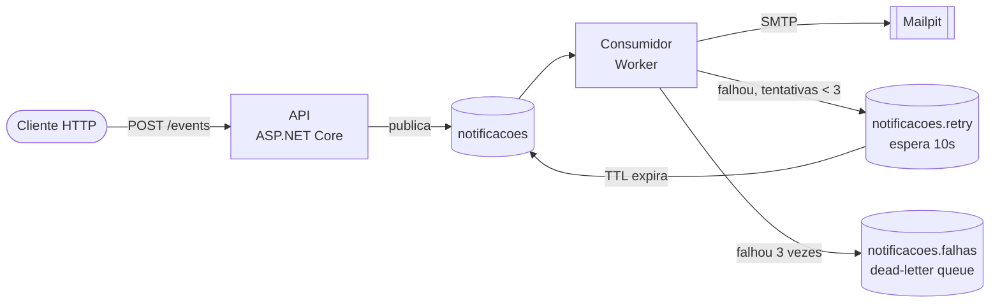

# Sistema de Notificações com Fila de Mensagens

[](https://github.com/MaduSantoss/sistema-notificacoes/actions/workflows/ci.yml)

Uma API REST recebe eventos de negócio (como "usuário se cadastrou" ou "pedido confirmado"), ...

Uma API REST recebe eventos de negócio (como "usuário se cadastrou" ou "pedido confirmado"), coloca-os numa fila no RabbitMQ e responde na hora. Um worker consome a fila de forma assíncrona e dispara o e-mail correspondente.

Quem pede a notificação não espera o e-mail sair, e as mensagens que chegam à fila são gravadas em disco e reenviadas automaticamente se o servidor de e-mail estiver fora do ar.

## Como funciona



1. O cliente envia um evento para `POST /events`.
2. A API valida o payload, gera um `eventId` se necessário, publica na fila `notificacoes` e responde `202 Accepted`.
3. O Consumidor lê a mensagem, escolhe o template pelo tipo do evento e envia o e-mail.
4. Só depois do envio ele confirma a mensagem (ack manual).
5. Se o envio falhar, a mensagem vai para `notificacoes.retry`, espera 10 segundos e volta para a fila principal. Após 3 falhas, vai para `notificacoes.falhas`, onde fica guardada para análise.

## Tecnologias

- .NET 10 (ASP.NET Core Minimal API e console worker)
- RabbitMQ (`RabbitMQ.Client` 7.x, API assíncrona)
- MailKit para envio SMTP
- Mailpit como caixa de e-mail falsa para desenvolvimento
- xUnit para testes
- Docker e Docker Compose

## Como rodar

Requisito: Docker. Não é preciso ter o .NET instalado.

```bash
docker compose up -d --build
```

Serviços disponíveis:

| Serviço | Endereço |
|---|---|
| API | http://localhost:8080 |
| Painel do RabbitMQ | http://localhost:15672 (guest / guest) |
| Caixa de entrada do Mailpit | http://localhost:8025 |

### Enviando um evento

PowerShell:

```powershell
Invoke-RestMethod -Method Post -Uri http://localhost:8080/events `
  -ContentType "application/json" `
  -Body '{"type":"user.registered","data":{"name":"Ana","email":"ana@exemplo.com"}}'
```

curl:

```bash
curl -X POST http://localhost:8080/events \
  -H "Content-Type: application/json" \
  -d '{"type":"user.registered","data":{"name":"Ana","email":"ana@exemplo.com"}}'
```

O e-mail aparece no Mailpit em poucos segundos.

### Tipos de evento

| `type` | Campos em `data` | E-mail gerado |
|---|---|---|
| `user.registered` | `name`, `email` | Boas-vindas |
| `order.confirmed` | `name`, `email`, `orderId`, `total` | Confirmação de pedido, com valor em reais |

Tipos desconhecidos são registrados no log e descartados. Payloads inválidos (campo ausente ou e-mail sem `@`) recebem `400` e não entram na fila.

O campo opcional `eventId` permite que o chamador informe um identificador próprio. Se omitido, a API gera um.

## Testes

```bash
dotnet test
```

Os testes cobrem a montagem dos e-mails (`TemplateEmail`).

## Estrutura

```
src/
  Api/          recebe eventos e publica na fila
  Consumidor/   consome a fila e envia os e-mails
  Shared/       contratos dos eventos
tests/
  Consumidor.Tests/
docker-compose.yml
```

## Decisões técnicas

- **RabbitMQ em vez de Redis Pub/Sub:** o Pub/Sub não guarda mensagens. Se o worker estiver fora do ar, elas se perdem. O RabbitMQ mantém as mensagens na fila até serem confirmadas.
- **Ack manual:** a mensagem só é confirmada depois do envio. Se o worker cair no meio, ela volta para a fila.
- **Retry com fila de espera:** `notificacoes.retry` tem TTL de 10 segundos e dead-letter para a fila principal, o que cria uma pausa entre tentativas sem bloquear o consumidor.
- **Dead-letter queue:** mensagens que falham 3 vezes são separadas em `notificacoes.falhas`, sem travar as demais.
- **Idempotência:** o Consumidor guarda os `eventId` já processados e ignora repetidos, evitando e-mails duplicados quando uma mensagem é reentregue.
- **`202 Accepted`:** a API só garante que o evento foi aceito e enfileirado, não que o e-mail já foi enviado.
- **Configuração por variáveis de ambiente:** `RABBITMQ_HOST` e `SMTP_HOST` (padrão `localhost`) permitem rodar tanto na máquina quanto em containers.
- **Mensagens persistentes:** a API publica com `Persistent = true`, então as mensagens são gravadas em disco e sobrevivem a um reinício do RabbitMQ. A fila já era durável, mas sem isso as mensagens dentro dela eram perdidas.

## Limitações conhecidas

- Os `eventId` processados ficam em memória. Se o Consumidor reiniciar, a lista é perdida e um evento repetido pode gerar e-mail duplicado. Em produção, usar Redis ou banco de dados.
- Mensagens em `notificacoes.falhas` não são reprocessadas automaticamente.
- A API usa um único canal do RabbitMQ compartilhado entre requisições.
- A validação do payload é feita à mão.
- Há apenas um canal de notificação (e-mail) e templates em texto simples.
- Enquanto o RabbitMQ está indisponível, a API devolve `500`. Ela se reconecta sozinha quando o broker volta, e quem chamou deve tentar de novo. Num sistema real, o ideal seria devolver `503`.

## Ideias de evolução

- Persistir os `eventId` em Redis ou banco de dados
- Rotina para reprocessar a fila de falhas
- Outros canais (SMS, push), cada um com sua fila
- Templates HTML
- Métricas e health checks
- Autenticação na API
